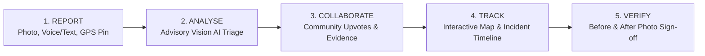
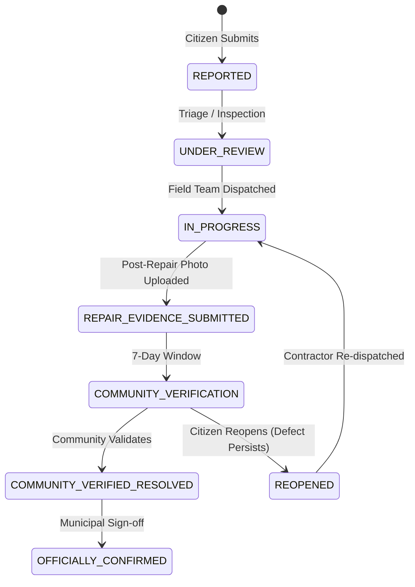
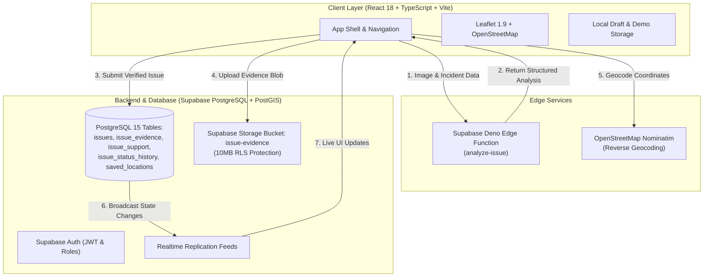

<div align="center">


<p align="center">
  <strong>Give Every Civic Problem a Memory.</strong><br/>
  <em>A community-powered civic intelligence platform transforming everyday observations into persistent, evidence-backed civic incidents.</em>
</p>

<br/>

[](https://react.dev/)
[](https://vitejs.dev/)
[](https://supabase.com/)
[](https://ai.google.dev/gemma)
[](https://leafletjs.com/)

</div>

---

## 📖 Table of Contents
1. [The Human Story & Problem Statement](#1-the-human-story--problem-statement)
2. [The Core Philosophy: Civic Issue Digital Twin](#2-the-core-philosophy-civic-issue-digital-twin)
3. [Supported Civic Domains](#supported-civic-domains)
4. [The End-to-End User Journey](#the-end-to-end-user-journey)
5. [AI Integration & Ethical Guardrails (Gemma 4 / Gemini)](#ai-integration--ethical-guardrails-gemma-4--gemini)
6. [Duplicate Detection & Geospatial Clustering (PostGIS)](#duplicate-detection--geospatial-clustering-postgis)
7. [CBRT Algorithm (Community-Based Risk & Triage)](#cbrt-algorithm-community-based-risk--triage)
8. [Anti-Ghost Resolution & Verification Workflow](#anti-ghost-resolution--verification-workflow)
9. [Detailed Technical Architecture & Security](#detailed-technical-architecture--security)
10. [Implementation Status: Honest Technical Audit](#implementation-status-honest-technical-audit)
11. [Local Development Setup](#local-development-setup)
12. [Business Viability, Scalability & Feasibility](#business-viability-scalability--feasibility)
13. [Limitations & Future Roadmap](#limitations--future-roadmap)
14. [License & Attribution](#license--attribution)

---

## 1. The Human Story & Problem Statement

### A Commute That Changed Everything
Every morning across Hyderabad, thousands of citizens make the same fragile commute.

On an ordinary Tuesday morning in Banjara Hills, an office commuter swerves sharply to avoid a wide, rainwater-obscured crater in the asphalt. Shaken and unsettled, they pull over to the side of the road, snap a quick photo on their smartphone, and post it into a neighbourhood WhatsApp group, tagging a municipal Twitter/X handle. A few neighbours respond with sympathetic frustration; two others mention having nearly crashed at the exact same bend earlier that week.

By nightfall, that distress message is buried beneath four hundred casual group chats, family videos, and forwarded memes.

Three weeks later, the monsoon season intensifies. Rainwater floods the unlit street, making the asphalt crater completely invisible. A gig worker on a delivery scooter strikes the edge of the submerged hole at speed, loses balance, and skids into oncoming traffic, suffering severe fractures and losing their daily livelihood.

When local municipal teams eventually arrive days later under public protest, there is **zero connected institutional memory**:
- *No record* that eighteen citizens had already reported that exact fault.
- *No record* of the hasty asphalt patch laid down two months earlier that washed away in the first shower.
- *No record* of who approved the temporary fix or why no subsurface drainage was installed.

---

### The Broken Status Quo
Municipal complaint mechanisms today treat civic reporting like a dead-end drop-box:

* **Fragmented Grief**: Complaints are scattered across private WhatsApp groups, social media tags, and bureaucratic toll-free hotlines that never connect the dots.
* **The "Ghost Resolution" Trap**: A municipal ticket is marked *"Resolved"* on an internal dashboard without an actual inspection or lasting repair. The citizen receives an automated SMS while the hazardous condition remains untouched on the road.
* **Zero Recurrence Memory**: When a bad repair crumbles, citizens are forced to start from scratch. There is no historical memory holding contractors or authorities accountable for recurring breakdowns.

> **A pothole or open drain is not just a digital photograph.**  
> It is an urgent, physical problem at a specific coordinate where real people live, walk, and raise families. It deserves a persistent, verifiable identity that cannot be swept away.

**NagrikAI** is a **Community-Powered Civic Intelligence Platform** that replaces disposable grievance tickets with persistent, geographically grounded **Civic Digital Twins**.

---

## 2. The Core Philosophy: Civic Issue Digital Twin

NagrikAI rejects the legacy "one-way complaint drop-box" model. Every civic breakdown reported on the platform becomes an active, observable digital asset:

1. **Persistent Unique Identity**: Every incident is assigned a standardized identifier (`NAG-YYYY-NNNNNN`).
2. **Permanent Original Evidence**: The initial photograph and report metadata cannot be silently overwritten or erased.
3. **Multi-Party Timeline**: The incident maintains an immutable audit trail of community upvotes, alternate camera perspectives, comments, and status transitions.
4. **Two-Sided Resolution Proof**: An issue cannot reach verified closure without post-repair photographic evidence, giving residents the final word to confirm or reopen unresolved defects.

---

## Supported Civic Domains

NagrikAI is designed for the full spectrum of urban infrastructure challenges—not merely potholes:

* **Road Damage & Asphalt Defects**: Potholes, alligator cracking, shoulder erosion, uneven road leveling.
* **Waterlogging & Flood Hazards**: Monsoon street inundation, clogged drainage channels, storm sewer overflows.
* **Streetlight & Illumination Failures**: Dark street stretches, malfunctioning timers, damaged poles.
* **Sanitation & Waste Overflow**: Uncollected curbside heaps, overflowing public dumpsters, illegal debris dumping.
* **Pedestrian & Footpath Degradation**: Broken paving stones, missing curbs, accessibility obstructions.
* **Critical Safety Hazards**: Uncovered or damaged manholes, exposed utility wiring, fallen trees.
* **Traffic & Public Utilities**: Signal outages, municipal water supply pipe ruptures, public transit stop damage.

---

## The End-to-End User Journey



### 1. REPORT (Smart Mobile Capture)
* **Visual Evidence**: Citizens upload original photographs with client-side file-type validation (JPEG, PNG, WebP) and 10MB size capping.
* **Multimodal Voice Input**: Native Web Speech API integration allows citizens to dictate their description in their regional accent.
* **Geospatial Pinning**: Automatic browser geolocation capture (`navigator.geolocation`) paired with an interactive Leaflet map pin-picker to set precise 5-decimal coordinates.
* **Draft Auto-Save**: In-progress reports are locally cached so citizens never lose input if network connectivity fluctuates.

### 2. ANALYSE (AI-Assisted Advisory Triage)
* Upon upload, the image is processed to generate advisory classifications: suggested category, estimated physical severity (High / Moderate / Low), potential impact risks, and suggested municipal actions.
* **Human-in-the-Loop**: Citizens retain full agency to review, edit, or override any suggested title, category, or description before publication.

### 3. COLLABORATE (Community Context)
* Neighbours endorse active reports with one-click **Support** upvotes.
* Community members upload **Additional Evidence** (alternate angles, low-light photos, traffic impact observations).
* Discussion threads allow residents to coordinate alerts (e.g. "School bus route affected between 8:00 AM – 9:00 AM").

### 4. TRACK (Interactive Geospatial Explorer)
* Incidents appear on an open-source OpenStreetMap canvas with custom color-coded category markers.
* Citizens and civic groups filter incidents by category, status, or neighborhood radius.
* **Saved Locations**: Users bookmark places of personal interest (Home, Workplace, School) to receive localized alerts on nearby civic events.

### 5. VERIFY (Anti-Ghost Resolution Engine)
* When field teams or contractors address a breakdown, a post-repair photograph is submitted.
* NagrikAI renders a **Before-and-After Side-by-Side Comparison** with timestamps.
* Nearby residents vote to confirm the resolution (`COMMUNITY_VERIFIED_RESOLVED`) or flag the issue as `REOPENED` if work was shoddy or incomplete.

---

## AI Integration & Ethical Guardrails (Gemma 4 / Gemini)

NagrikAI integrates open-weight Google Gemma models (`gemma-4-31b-it` / `gemma-4-26b-a4b-it`) hosted via serverless Supabase Edge Functions, with direct Google Gemini SDK integration.

```
                    ┌───────────────────────────────────┐
                    │    Citizen Photograph Upload      │
                    └─────────────────┬─────────────────┘
                                      │
                                      ▼
                    ┌───────────────────────────────────┐
                    │     Supabase Edge Function        │
                    │  (Server-Side API Key Protection) │
                    └─────────────────┬─────────────────┘
                                      │
              ┌───────────────────────┴───────────────────────┐
              ▼                                               ▼
┌───────────────────────────┐                   ┌───────────────────────────┐
│ Gemma 4 Multimodal Engine │                   │ Resilient Fallback Engine │
│ - Physical hazard extraction│                 │ - Rule-based heuristics   │
│ - Vulnerability modeling  │                   │ - Safe advisory defaults  │
│ - Strict safety prompts   │                   │ - Zero reporting friction │
└───────────────────────────┘                   └───────────────────────────┘
```

### Ethical AI Rules & Constraints
1. **Advisory by Definition**: AI results are explicitly designated as *resident observations*, never as authoritative legal or structural engineering inspections.
2. **Strict Safety Guardrails**: The system prompt strictly prohibits hazardous DIY advice (e.g. the AI will never instruct citizens to enter standing floodwaters, handle exposed wires, or attempt asphalt repairs).
3. **No Silent Blackouts**: If the AI endpoint times out or is unreachable, the system gracefully falls back to structured heuristic defaults without halting the user's reporting workflow.
4. **Server-Side Secret Hygiene**: Model keys are maintained in protected Supabase Edge Function secrets; private credentials are never exposed in client bundles.

---

## Duplicate Detection & Geospatial Clustering (PostGIS)

Civic reporting systems frequently suffer from "duplicate ticket fatigue," where 50 residents submit disconnected reports about the same incident.

* **Spatial Proximity Queries**: Before finalizing a submission, the system evaluates active incidents within a defined radius (e.g. 300 meters) using PostGIS spatial functions (`ST_DWithin`).
* **Transparent Suggestions**: Rather than automatically merging incidents without consent, the UI displays *"Potentially related nearby issues"* with their photos, IDs, and statuses.
* **Constructive Collaboration**: Citizens can choose to add their upvote or upload secondary evidence to an existing ticket instead of polluting municipal queues with redundant entries.

---

## CBRT Algorithm (Community-Based Risk & Triage)

NagrikAI utilizes the **Community-Based Risk & Triage (CBRT)** algorithm to establish an objective, weighted priority score from 0 to 100:

$$\text{CBRT Score} = \min\left(100, S_{\text{severity}} + S_{\text{impact}} + S_{\text{support}} + S_{\text{age}} + S_{\text{recurrence}}\right)$$

### Factor Breakdown & Normalization:
* **Severity Subscore ($0 - 20$)**: Evaluates physical risk to human safety. High-risk hazards (open manholes, live wires) receive immediate top scores.
* **Public Impact Subscore ($0 - 25$)**: Calculated based on the number of commuters, pedestrians, and transport hubs impacted.
* **Community Support Subscore ($0 - 20$)**: Normalized upvotes from local residents ($\approx 1.4 \times \text{Supporters}$, capped at 20).
* **Unresolved Age Subscore ($0 - 20$)**: Gradually escalates as a ticket sits unattended ($\text{Days} / 30 \times 20$, capped at 20).
* **Recurrence Penalty Subscore ($0 - 15$)**: Heavily penalizes issues that have been repeatedly reopened at the same coordinates.

> **Safety-First Design**: Community upvotes are deliberately bounded to 20% of the total score. This prevents high-density social upvoting from deprioritizing an urgent safety hazard (e.g. an open manhole) in a quiet residential alley.

---

## Anti-Ghost Resolution & Verification Workflow



* **Audit Logging**: Every status update logs the initiating actor ID, status enum, and verification notes in PostgreSQL (`issue_status_history`).
* **Evidence Immutability**: Dedicated database triggers safeguard the original reporting photograph from being replaced when repair evidence is attached.

---

## Detailed Technical Architecture & Security



### Security & Data Protection Measures
* **PostgreSQL Row Level Security (RLS)**: Enforced across all tables. Public read access supports civic transparency; authenticated write access enforces identity verification.
* **Storage Isolation**: User uploads are segregated by authenticated user IDs (`auth.uid()`) with strict image MIME type validation.
* **Privacy & Anonymity**: Reporters can choose anonymous public display, shielding personal citizen details from public scrapers while retaining accountability for administrative audit.

---

## Implementation Status: Honest Technical Audit

To maintain technical credibility, this project clearly distinguishes between features that are live, partially implemented, or planned:

| Feature Area | Current Implementation Status | Notes & Behavior |
|:---|:---:|:---|
| **Incident Reporting Wizard** | ✅ **Fully Implemented** | Photo upload, Web Speech voice input, Leaflet map pin-drop, local draft saving. |
| **Gemma 4 Multimodal Analysis** | ✅ **Fully Implemented** | Edge function integration with resilient heuristic fallback. |
| **Civic Issue Digital Twin** | ✅ **Fully Implemented** | Unique ticket IDs (`NAG-2026-000001`), database persistence, original evidence protection. |
| **PostGIS Proximity & Deduplication** | ✅ **Fully Implemented** | Proximity lookup queries active incidents within the vicinity. |
| **CBRT Priority Scoring** | ✅ **Fully Implemented** | Transparent multi-factor calculation balancing safety hazards against community upvotes. |
| **Before & After Repair Workflow** | ✅ **Fully Implemented** | Side-by-side comparison, community verification voting, reopen capability. |
| **Interactive Civic Map** | ✅ **Fully Implemented** | Leaflet rendering, custom category pins, status filters, popup details. |
| **Saved Locations & Locality Feed** | ✅ **Fully Implemented** | Full database persistence (`saved_locations` table), PostGIS coordinate binding, one-click bookmarking of Home/Work/Commute routes, and dedicated locality incident feed. |
| **Municipal ERP Integration** | ⏳ **Planned / Future** | Direct API sync with municipal work-order systems (e.g. GHMC ERP) requires administrative MoUs. |
| **Multi-Language Regional Voice** | ⏳ **Planned / Future** | Hindi and Telugu dialect speech models planned for subsequent phases. |

---

## Local Development Setup

Follow these steps to run NagrikAI locally:

### 1. Prerequisites
* **Node.js**: `v20.0.0` or higher
* **npm** or **pnpm**
* *(Optional)* Supabase CLI for database migrations

### 2. Installation
```bash
git clone https://github.com/Kanneboinashivakumar/NagrikAI.git
cd NagrikAI
npm install
```

### 3. Environment Configuration
Create a `.env.local` file based on `.env.example`:
```ini
# Supabase Configuration
VITE_SUPABASE_URL=https://your-project.supabase.co
VITE_SUPABASE_ANON_KEY=your-supabase-anon-key

# OpenStreetMap Geocoding
VITE_GEOCODING_URL=https://nominatim.openstreetmap.org

# Google AI Studio API Key (Optional for Gemma/Gemini edge analysis)
VITE_GEMINI_API_KEY=your-api-key-here
```

> **Note**: NagrikAI includes pre-seeded Hyderabad demo incidents and client-side persistence so the application can be explored immediately without mandatory cloud backend keys.

### 4. Running the Dev Server
```bash
npm run dev
```
Open [http://localhost:4173](http://localhost:4173) in your browser.

### 5. Production Build
```bash
npm run build
```

---

## Business Viability, Scalability & Feasibility

NagrikAI is free for citizens to ensure frictionless adoption, while sustaining its operations through targeted institutional offerings:

### 1. Revenue Opportunities (B2G & B2B)
* **Municipal Smart City Dashboard (B2G SaaS)**: Subscriptions for municipal corporations (e.g. GHMC, BBMP) providing automated dispatch routing, contractor SLA performance auditing, and predictive maintenance heatmaps.
* **Contractor Proof-of-Work Verification (B2B)**: Civil engineering and road maintenance concessionaires license digital verification dossiers to substantiate invoice approvals.
* **Geospatial Road Risk API (B2B Enterprise)**: Real-time hazard APIs licensed by logistics fleets (Swiggy, Zomato, Amazon, Uber) and insurance underwriters to navigate two-wheeler couriers away from hazardous flooded streets.
* **Private Gated Townships & Campuses**: Tailored facility-management packages for large private tech parks, universities, and residential enclaves.

### 2. Scalability Architecture
* **Geospatial R-Tree Indexing**: PostGIS `GIST` indices execute spatial bounding box queries in sub-5ms across hundreds of thousands of incident coordinates.
* **Edge-Optimized AI**: Utilizing open-weight Gemma models allows serverless edge compute without per-token proprietary API vendor lock-in.
* **City-Level Multi-Tenancy**: The database schema is partitioned by geographic boundaries (`boundary_polygon`), allowing seamless expansion to new metropolitan areas without code refactoring.

### 3. Technical Feasibility
* **Zero Custom Hardware**: Leverages the smartphones already in citizens' pockets, avoiding the massive capital expenditure and maintenance overhead of roadside IoT sensors.
* **Independent Community Utility**: Operates bottom-up without requiring formal government gatekeeping before delivering immediate local community value.

---

## Limitations & Future Roadmap

### Current Limitations
* **Advisory Physical Classification**: AI analysis provides visual degradation context; it cannot evaluate subsurface soil moisture, load-bearing capacities, or concealed utility pipelines.
* **Community-Led Moderation**: Relies on community verification and peer flagging to address erroneous or misclassified reports.

### Strategic Roadmap
* **PWA & Offline Mesh Syncing**: Peer-to-peer mesh synchronization for remote offline environments during monsoon blackouts.
* **Regional Language Localisation**: Natural speech and UI support for Telugu, Hindi, and Urdu.
* **Automated Municipal Dispatch Bridges**: Developing open standards-compliant webhooks for GHMC and Smart City Command & Control Centers.

---

## License & Attribution

* **Software License**: Distributed under the MIT Open Source License.
* **Map Tiles & Data**: © [OpenStreetMap](https://www.openstreetmap.org/copyright) contributors.
* **Geocoding**: Powered by [Nominatim](https://nominatim.org/).
* **AI Architecture**: Google Gemma & Gemini family via Google AI for Developers.

---

<div align="center">
  <em>NagrikAI — Transforming everyday citizen observations into lasting civic memory.</em>
</div>
