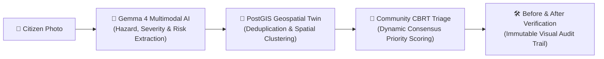
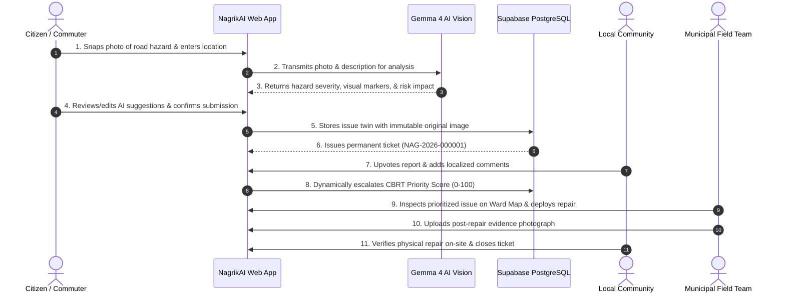
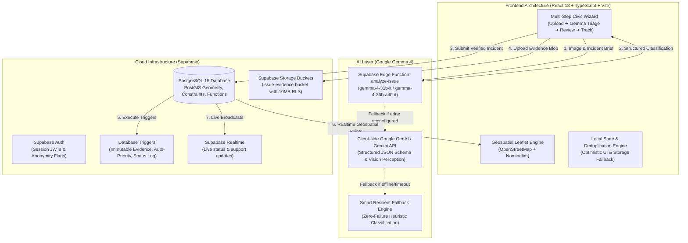

# NagrikAI 🏛️⚡

> **Give Every Civic Problem a Memory.**  
> *A community-powered civic intelligence platform that transforms everyday observations into persistent, evidence-backed civic incidents.*

[](https://react.dev/)
[](https://vitejs.dev/)
[](https://supabase.com/)
[](https://ai.google.dev/gemma)
[](https://leafletjs.com/)

---

## 📖 Table of Contents
1. [The Human Story](#-the-human-story)
2. [The Core Philosophy](#-the-core-philosophy)
3. [The Problem & Our Solution](#-the-problem--our-solution)
4. [Why Gemma 4? Transforming Civic Intelligence](#-why-gemma-4-transforming-civic-intelligence)
5. [Feature Catalogue](#-feature-catalogue)
6. [Visual Walkthrough](#-visual-walkthrough)
7. [The Complete User Journey](#-the-complete-user-journey)
8. [Technical Architecture](#-technical-architecture)
9. [Repository Structure](#-repository-structure)
10. [Local Development Setup](#-local-development-setup)
11. [Data, Privacy & Security](#-data-privacy--security)
12. [Honest Social Impact & Limitations](#-honest-social-impact--limitations)
13. [Hackathon & Track Alignment](#-hackathon--track-alignment)

---

## 🌟 The Human Story

Every morning in Hyderabad, thousands of residents navigate the same broken stretch of road. 

A commuter swerves to avoid a deep, water-filled pothole near the Banjara Hills intersection. Shaken, they stop, snap a quick photo, and post it to a local WhatsApp community group or tag a municipal handle on social media. A few neighbours reply with frustration; others share similar experiences. 

By evening, the message has been buried under hundreds of daily group chats. 

Two weeks later, heavy monsoon rain obscures the same crater. A delivery partner on a scooter strikes it and crashes. When authorities eventually arrive after repeated complaints, there is no shared record of when the road first cracked, how many citizens reported it, or whether earlier patch attempts had already washed away.

> **A pothole is not just a photograph.**  
> It is a problem at a particular location, affecting real people, with a history that deserves to be remembered.
>
> NagrikAI helps communities turn isolated civic observations into persistent, evidence-backed incidents that people can report, explore, support, and follow over time.

---

## 💡 The Core Philosophy

**Civic issues should not disappear into scattered complaints.** Their evidence, history, community contributions, and progress should remain connected.

Traditional municipal portals treat civic reporting as a one-way ticketing counter: a resident files a complaint, receives an opaque ticket number, and waits in silence. If the ticket is closed without a photo or actual inspection, the resident is left powerless.

NagrikAI introduces the **Civic Issue Digital Twin**:
- Every physical civic failure receives an immutable identity (`NAG-YYYY-NNNNNN`).
- Original photographic evidence is cryptographically preserved and cannot be overwritten.
- Community members add supporting upvotes, additional angles, and localized comments.
- Resolution requires **verifiable before-and-after photographic proof**, empowering residents to confirm repairs or reopen issues if work was incomplete.

---

## 📌 The Problem & Our Solution

### The Broken Status Quo
- **Fragmented Channels**: Complaints are scattered across Twitter, WhatsApp, municipal phone lines, and ward offices with zero centralized visibility.
- **Duplicate & Unstructured Noise**: When a streetlight fails, thirty citizens submit thirty vague, disconnected complaints ("light not working near temple"), overwhelming municipal field workers.
- **Opaque Triage**: High-risk safety hazards (such as open manholes on dark school routes) often sit behind cosmetic issues because municipal queues lack automated risk quantification.
- **Ghost Resolutions**: Tickets are frequently marked "Resolved" on municipal dashboards without verifiable proof, breeding deep cynicism and citizen apathy.

### The NagrikAI Solution


1. **Multimodal AI Visual Inspection**: Evaluates photos through Google Gemma 4 to extract physical degradation markers, severity classifications, and traffic/pedestrian risks.
2. **Geospatial Issue Twins**: Connects incoming reports to geographic coordinates on OpenStreetMap, automatically detecting nearby duplicates and clustering recurring breakdowns.
3. **CBRT Community Prioritization**: A transparent 0–100 Community-Based Risk & Triage score combines severity, population impact, recurrence, and resident endorsements.
4. **Two-Sided Evidence Loop**: An issue cannot reach `COMMUNITY_VERIFIED_RESOLVED` without verifiable post-repair evidence uploaded by field workers or residents.

---

## 🧠 Why Gemma 4? Transforming Civic Intelligence

NagrikAI is built on **Google Gemma 4** (`gemma-4-31b-it` and `gemma-4-26b-a4b-it`) via modern Supabase Edge Functions with a resilient, zero-failure client fallback.

```
                                  ┌─────────────────────────────────────────┐
                                  │           Citizen Photo Upload          │
                                  └────────────────────┬────────────────────┘
                                                       │
                                                       ▼
                         ┌───────────────────────────────────────────────────────────┐
                         │   Gemma 4 Multimodal Civic Intelligence Engine            │
                         │   (Edge Runtime: gemma-4-31b-it / gemma-4-26b-a4b-it)     │
                         └─────────────────────────────┬─────────────────────────────┘
                                                       │
         ┌────────────────────────┬────────────────────┴────────────────┬────────────────────────┐
         ▼                        ▼                                     ▼                        ▼
┌──────────────────┐    ┌──────────────────┐                  ┌──────────────────┐    ┌──────────────────┐
│ Feature Detection│    │ Severity Scoring │                  │  Impact Matrix   │    │ Safety Safeguards│
│ • Asphalt crater │    │ • HIGH (0.92)    │                  │ • Two-wheelers   │    │ • NO DIY repairs │
│ • Standing water │    │ • Medium / Low   │                  │ • Night hazard   │    │ • Keep distance  │
│ • Edge erosion   │    │ • Uncertain flag │                  │ • Sidewalk block │    │ • Electrical alert│
└──────────────────┘    └──────────────────┘                  └──────────────────┘    └──────────────────┘
```

### 1. High-Precision Physical Hazard Extraction
Generic language models often produce vague conversational summaries. Gemma 4's vision-language architecture enables granular visual feature recognition tailored to complex Indian urban environments:
- Distinguishes **asphalt raveling, alligator cracking, and structural potholes**.
- Identifies **waterlogging depth indicators** and standing water near drainage grates.
- Detects **uncovered manholes, dangling high-tension cables, and pedestrian walkway blockages**.

### 2. Multi-Dimensional Risk & Impact Modeling
Rather than just assigning a category, Gemma 4 evaluates the real-world consequence:
- **Vulnerable Road Users**: Identifies acute collision and spill hazards for two-wheelers, cyclists, and pedestrians.
- **Weather Sensitivity**: Evaluates risk amplification during monsoons (e.g., hidden depths under dirty water).
- **Public Health & Sanitation**: Identifies uncollected organic waste, pest breeding hazards, and drain clogs.

### 3. Ethical Safeguards & Safety-First Output
Civic AI must never encourage citizens to put themselves in danger. NagrikAI's system prompt enforces strict safety boundaries:
- **Strictly forbids hazardous DIY advice**: The model will never suggest that a citizen enter floodwaters, handle exposed electrical wiring, touch biohazardous waste, or repair asphalt themselves.
- **Cautionary Advisory Role**: Explicitly labels AI insights as *advisory resident observations*, ensuring AI never claims an official inspection or legal liability.

### 4. Resilient Offline / Silent Fallback Architecture
Civic infrastructure tools must function in low-connectivity areas or during cloud service degradation:
- If edge AI inference encounters timeouts or credential constraints, NagrikAI smoothly transitions to an intelligent local heuristic analysis.
- **Zero error banners**: The citizen's reporting flow is never interrupted, ensuring urgent safety hazards are captured reliably regardless of network conditions.

---

## 🛠️ Feature Catalogue

### A. Authentication & Citizen Privacy
- **Supabase Authentication**: Secure email sign-in, sign-up, and session persistence.
- **Privacy & Anonymity Controls**: Reporters can toggle anonymous publishing while keeping contact metadata accessible strictly to verified municipal teams.
- **Resident Profile**: Track submitted issues, upvotes given, community validations, and active badges.

### B. Multi-Step Civic Issue Reporting
- **18 Comprehensive Civic Categories**:
  - *Road Damage, Waterlogging, Streetlight Failure, Garbage Overflow, Broken Footpath, Blocked Drainage, Open Manhole, Fallen Tree, Construction Hazards, Traffic Signal Outage, Public Safety, Water Supply Leakage, Park Maintenance, Public Transport, Stray Animals, Encroachment, Noise Pollution, and Custom Concerns.*
- **Drag-and-Drop Photo Upload**: Built-in MIME type validation (`jpeg`, `png`, `webp`) and 10MB size capping.
- **Geocoding & Location Picker**: OpenStreetMap Nominatim integration with reverse geocoding, landmark tags, and GPS coordinates.
- **Interactive Review & Edit**: Full citizen control to edit, refine, or override AI-suggested titles, severity tags, and descriptions before database submission.

### C. The Civic Memory / Issue Twin
- **Permanent Identifiers**: Every incident receives a standardized ticket code (`NAG-2026-000001`).
- **Immutable Original Evidence**: A PostgreSQL database trigger (`protect_original_evidence`) ensures the initial reporting photograph can never be deleted or altered by subsequent edits.
- **Comprehensive Audit History**: Every state change (`REPORTED` $\rightarrow$ `UNDER_REVIEW` $\rightarrow$ `IN_PROGRESS` $\rightarrow$ `REPAIR_EVIDENCE_SUBMITTED` $\rightarrow$ `COMMUNITY_VERIFIED_RESOLVED`) is logged in `issue_status_history` with actor IDs, timestamps, and notes.

### D. Interactive Civic Map
- **Full-Screen Leaflet Geospatial View**: Explores incidents across Hyderabad's wards (Banjara Hills, Jubilee Hills, Madhapur, Charminar, Kukatpally, Gachibowli, Secunderabad, etc.).
- **Dynamic Category & Status Pin Styling**: Color-coded markers indicating category type and resolution state.
- **Interactive Inspection Popups**: Displays thumbnail preview, ticket ID, category, location, and a direct button to inspect the full issue twin.

### E. Community Collaboration & CBRT Triage
- **One-Click Support (Upvotes)**: Residents endorse active issues, boosting their visibility and escalating triage priority.
- **CBRT (Community-Based Risk & Triage) Score**: A transparent, weighted 0–100 algorithm:
  $$\text{CBRT Score} = \min\left(100, \text{Severity}\times 12 + \text{Impact}\times 20 + \text{Community Upvotes}\times 10 + \text{Unresolved Age}\times 25 + \text{Recurrence}\times 15\right)$$
- **Discussion Feed**: Verified local residents contribute updates, alternate angles, and route cautions.
- **Duplicate Prevention**: Automated duplicate detection prevents double submissions within 5-minute spatial windows.

### F. Before & After Repair Evidence Verification
- **Two-Sided Photographic Evidence**: Original hazard photo juxtaposed against post-repair evidence.
- **Community Resolution Voting**: Residents who live or commute nearby verify whether the repair was executed properly.
- **Reopen Workflow**: If a patch washes away within weeks, residents can reopen the ticket, incrementing its recurrence penalty.

### G. Contribution Points & Citizen Impact
- **Civic Karma**: Earn points for filing verified reports, adding photographic evidence, and participating in resolution verifications.
- **Safety First**: Point systems are strictly informational and do not allow popularity contests to outrank urgent, hazardous safety defects.

---

## 📸 Visual Walkthrough

| Screen | Description | Asset Preview |
|:---|:---|:---:|
| **Landing & Impact Hero** | Overview of active issues, resolved tickets, and community metrics across Hyderabad. | `NagrikAI-assets/home.png` |
| **Civic Reporting Wizard** | Step 1 photo capture, title, description, and auto-geolocation coordinate lookup. | `NagrikAI-assets/NagrikAI Report Issue Dashboard.png` |
| **Gemma 4 AI Inspection** | Multi-dimensional visual perception: severity, visible hazard details, impact notes, and suggested next steps. | `NagrikAI-assets/NagrikAI AI Analysis Dashboard-3.png` |
| **Review & Verification** | Citizen-in-the-loop review interface with location map pin confirmation and anonymity toggle. | `NagrikAI-assets/NagrikAI Review & Submit Dashboard.png` |
| **Interactive Ward Map** | OpenStreetMap geospatial explorer with custom category markers and status filtering. | `NagrikAI-assets/NagrikAI Hyderabad Civic Map.png` |
| **Community Triage Feed** | Community incident feed featuring real-time CBRT scores, support upvotes, and locality filters. | `NagrikAI-assets/NagrikAI Community Dashboard.png` |
| **Before & After Twin** | Comparative visual inspection showing original road damage alongside verified repair evidence. | `NagrikAI-assets/NagrikAI Issue Detail_ Before and After.png` |
| **Impact Dashboard** | Ward-level health, resolution velocity, and municipal accountability metrics. | `NagrikAI-assets/NagrikAI Civic Impact Dashboard.png` |

---

## 🗺️ The Complete User Journey



---

## 🏗️ Technical Architecture



### Technology Breakdown
- **Frontend Core**: React 18, TypeScript, Vite, Tailwind CSS, Lucide React
- **Geospatial & Mapping**: Leaflet 1.9, React-Leaflet 4.2, OpenStreetMap tiles, Nominatim Geocoding API
- **AI Vision & Understanding**: Google Gemma 4 (`gemma-4-31b-it`, `gemma-4-26b-a4b-it`), Google GenAI SDK / Gemini API REST interface
- **Backend & Database**: Supabase PostgreSQL with PostGIS extensions (`geography(point, 4326)`)
- **Storage & Security**: Supabase Storage (`issue-evidence` bucket) with Row Level Security (RLS) policies
- **Edge Compute**: Supabase Deno Edge Functions

---

## 📂 Repository Structure

```text
NagrikAI/
├── NagrikAI-assets/                  # Visual UI design assets, banners, and screenshots
│   ├── home.png
│   ├── NagrikAI AI Analysis Dashboard-3.png
│   ├── NagrikAI Hyderabad Civic Map.png
│   ├── NagrikAI Community Dashboard.png
│   ├── NagrikAI Issue Detail_ Before and After.png
│   └── ...
├── public/                           # Static production assets
│   ├── NagrikAI-assets/              # Web-optimized imagery and avatar previews
│   └── favicon.svg                   # Civic platform brand icon
├── src/                              # Main application source code
│   ├── lib/
│   │   └── supabase.ts               # Supabase client initialization & connection check
│   ├── App.tsx                       # Core application: routing, screens, Gemma triage & state
│   ├── main.tsx                      # React root entrypoint
│   ├── styles.css                    # Tailwind utility overrides and custom design tokens
│   └── vite-env.d.ts                 # TypeScript environment definitions
├── supabase/
│   ├── functions/
│   │   └── analyze-issue/
│   │       └── index.ts              # Edge function: Gemma 4 multimodal vision analysis
│   └── migrations/
│       ├── 202610240001_initial_schema.sql         # PostGIS, issues, evidence, CBRT trigger
│       ├── 202610250001_auth_issue_ids.sql         # Standardized NAG-YYYY-NNNNNN ticket IDs
│       ├── 202610250002_public_reporter_names.sql  # Resident privacy & anonymity policies
│       ├── 202610250003_notification_context.sql  # Event notifications & follower feeds
│       └── 202610250004_saved_location_issue_link.sql # Saved geographic zones
├── Test Data/                        # Unverified test hazard photos (potholes, garbage, flood)
├── .env.example                      # Sanitized environment template
├── index.html                        # HTML entry point with responsive viewport settings
├── package.json                      # Project dependencies and build scripts
├── tsconfig.json                     # TypeScript compilation configuration
└── vite.config.ts                    # Vite bundler configuration
```

---

## 💻 Local Development Setup

Follow these straightforward steps to run NagrikAI locally on **Windows, macOS, or Linux**:

### 1. Prerequisites
- **Node.js**: `v20.0.0` or higher
- **npm** or **pnpm**
- *(Optional)* Supabase CLI for local database migrations

### 2. Clone and Install Dependencies
```bash
git clone https://github.com/Kanneboinashivakumar/NagrikAI.git
cd NagrikAI
npm install
```

### 3. Configure Environment Variables
Copy `.env.example` to `.env.local`:
```bash
cp .env.example .env.local
```

Fill in your configuration details:
```ini
# Supabase Configuration (Obtain from your Supabase Project Settings -> API)
VITE_SUPABASE_URL=https://your-project.supabase.co
VITE_SUPABASE_ANON_KEY=your-supabase-anon-key

# OpenStreetMap Geocoding Service
VITE_GEOCODING_URL=https://nominatim.openstreetmap.org

# Google Gemma / Gemini API Key (For visual issue analysis)
VITE_GEMINI_API_KEY=your-api-key-here
```

> **Note**: NagrikAI includes pre-seeded Hyderabad demo incidents and local state management so you can explore the entire workflow immediately without requiring external backend credentials.

### 4. Apply Database Migrations (Optional for Full Cloud Backend)
If connecting to your own Supabase project:
```bash
# Using Supabase CLI
npx supabase login
npx supabase link --project-ref your-project-ref
npx supabase db push
```
Alternatively, execute the SQL files in `supabase/migrations/` sequentially inside the **Supabase SQL Editor**.

### 5. Deploy the Gemma Edge Function (Optional)
```bash
npx supabase secrets set GEMINI_API_KEY=your-api-key GEMINI_MODEL=gemma-4-31b-it
npx supabase functions deploy analyze-issue
```

### 6. Run Development Server
```bash
npm run dev
```
Open `http://localhost:4173` in your browser.

### 7. Run Production Build
```bash
npm run build
```

---

## 🔒 Data, Privacy & Security

| Layer | Implemented Protections |
|:---|:---|
| **Database Policies** | Strict PostgreSQL **Row Level Security (RLS)** applied to all 11 tables. Public reads are permitted for community transparency, while write operations enforce authentication checks. |
| **Evidence Immutability** | A dedicated database trigger (`protect_original_evidence`) ensures that original photo URLs cannot be modified or replaced once created. |
| **Reporter Anonymity** | The `profiles` schema and `public_reporter_names` migration allow citizens to mask their legal names on public issue cards while retaining auditability for municipal field teams. |
| **Storage Isolation** | The `issue-evidence` bucket isolates uploads into authenticated user folders (`auth.uid()`), capping image payloads at 10MB and enforcing strict image MIME types. |
| **Zero Secret Exposure** | API keys for Google Gemma / Gemini are stored as server-side environment variables or Supabase Vault secrets; administrative service-role keys are never packaged into client builds. |

---

## 🌍 Honest Social Impact & Limitations

### Measurable Civic Value
- **Zero-Friction Documentation**: Cuts reporting time from 10 minutes on bureaucratic forms down to under 60 seconds with automated visual extraction.
- **Accident Prevention**: Elevates hazardous road conditions and open manholes through automated multi-dimensional risk scoring before injuries occur.
- **Public Accountability**: Closes the loop on "ghost resolutions" by mandating verifiable before-and-after photographic evidence.

### Current Limitations & Future Roadmap
- **Municipal Integration**: Currently operates as a community intelligence layer. Direct, bi-directional synchronization with municipal ERPs (such as GHMC's internal dispatch systems) requires formal administrative MoUs and custom API bridges.
- **Advisory AI**: Gemma 4 provides *advisory physical classification*. It cannot replace structural engineering inspections or assess sub-surface utility pipeline integrity.
- **Offline Mesh Syncing**: While resilient offline fallback is implemented for report creation, peer-to-peer mesh synchronization for remote offline areas remains planned for future iterations.

---

## 🏆 Hackathon & Track Alignment

### Best Use of Gemma 4
NagrikAI demonstrates a deeply practical, human-centric application of **Google Gemma 4**:
1. **Edge-Ready Civic Multimodal Understanding**: Leverages Gemma's open weights to perform complex physical street degradation analysis without exposing citizen photos to closed proprietary black boxes.
2. **Context-Aware Safety Guardrails**: Uses custom system prompting to prevent hazardous citizen behaviors while extracting actionable municipal remediation steps.
3. **Resilient Dual-Path Architecture**: Demonstrates how open AI models can be deployed on serverless edge functions with seamless, graceful client fallback.

---

## 📄 License & Attribution
- **Codebase**: Built for community empowerment and open civic innovation.
- **Map Data**: © [OpenStreetMap](https://www.openstreetmap.org/copyright) contributors.
- **Geocoding**: Powered by [Nominatim](https://nominatim.org/).
- **AI Models**: Google Gemma & Gemini family via Google AI for Developers.

---

*NagrikAI — Transforming everyday citizen observations into lasting civic memory.*
