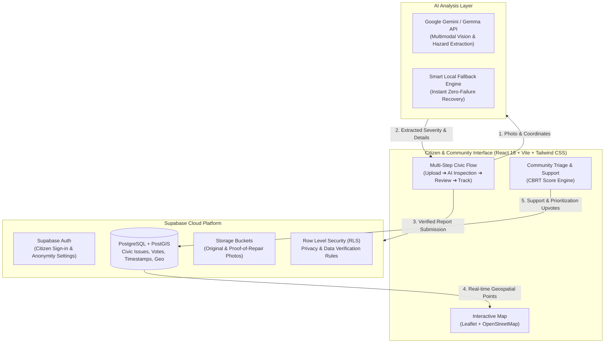

# NagrikAI 🏛️⚡

> **Citizen-Powered Civic Intelligence & Action Platform for Hyderabad**  
> Streamlining civic issue reporting, automated AI hazard analysis, and community-driven municipal prioritization.

---

## 📌 The Problem

In fast-growing metropolitan cities like Hyderabad, civic infrastructure breakdowns—such as dangerous potholes, overflowing waste bins, broken streetlights, and monsoon waterlogging—frequently suffer from:

1. **Slow & Inconvenient Reporting**: Citizens find municipal portals cumbersome, requiring manual category codes, exact ward numbers, and lengthy forms.
2. **Duplicate & Unstructured Submissions**: Multiple complaints for the same road hazard flood civic authorities without deduplication or priority ranking.
3. **Lack of Transparent Prioritization**: Critical safety hazards often wait in line behind minor issues with no objective impact scoring.
4. **Opaque Resolution & Trust Deficit**: Citizens rarely know whether their issue was verified, assigned, or resolved with actual proof.

---

## 💡 What We Are Solving & How

**NagrikAI** bridges the gap between citizens and municipal authorities (such as GHMC) using an intelligent, transparent civic pipeline:

1. **Instant AI Visual Inspection**: Citizens snap or upload a photo. Multimodal AI (Gemini / Gemma Vision) automatically extracts the hazard category, severity score, hazard impacts (traffic, pedestrians, road safety), and suggested remediation steps.
2. **Resilient Offline / Silent Fallback**: If network or AI edge services face latency, NagrikAI smoothly transitions to local heuristic analysis without interrupting citizen workflow or showing error banners.
3. **Automated Deduplication**: Submissions are cross-referenced spatially and temporally to prevent parallel duplicate complaints.
4. **Community Priority Scoring (CBRT)**: Issues receive dynamic priority estimates based on resident upvotes ("Support"), severity, location recurrence, and age.
5. **Interactive Ward Map**: Real-time geospatial mapping on OpenStreetMap displays active reports, filters by category/severity, and pinpoints resolution statuses across Hyderabad.

---

## 🏗️ Architecture



---

## ✨ Key Features

- **4-Step Intuitive Reporting Flow**:
  - **Step 1 - Upload**: Upload photos with auto-geolocation and image preview.
  - **Step 2 - AI Analysis**: Real-time visual analysis with confidence scores, impact factors, editable fields, and nearby report detection.
  - **Step 3 - Review & Confirmation**: Clean summary breakdown of location, ward, description, and anonymity toggle.
  - **Step 4 - Submission Ticket**: Live tracking ticket with direct links to dashboard, live map location, and shareable link.
- **Dynamic Community Support**: Clicking "Support Issue" boosts community consensus and immediately updates the municipal priority estimate across the entire platform.
- **Explore & Ward Map**: Filter issues by status (*Reported*, *Investigating*, *In Progress*, *Resolved*), category, and severity with custom map pins.
- **Deduplication Engine**: Built-in duplicate detection protects municipal teams from redundant requests.

---

## 🛠️ Tech Stack

- **Frontend**: React 18, TypeScript, Vite, Tailwind CSS, Lucide Icons, Leaflet / React-Leaflet
- **AI & Vision**: Google Gemini API / Gemma models via Supabase Edge Functions with resilient browser fallback
- **Backend & Database**: Supabase (PostgreSQL, PostGIS, Auth, Storage, Edge Functions)
- **Maps & Geocoding**: OpenStreetMap, Nominatim API

---

## 🚀 Getting Started

### 1. Prerequisites
- Node.js 20+
- npm or pnpm

### 2. Installation
```bash
git clone https://github.com/your-username/NagrikAI.git
cd NagrikAI
npm install
```

### 3. Environment Configuration
Create a `.env.local` file in the root directory:
```env
VITE_SUPABASE_URL=https://YOUR_PROJECT_REF.supabase.co
VITE_SUPABASE_ANON_KEY=YOUR_SUPABASE_PUBLISHABLE_OR_ANON_KEY
VITE_GEOCODING_URL=https://nominatim.openstreetmap.org
```

> **Note**: NagrikAI includes pre-seeded Hyderabad sample reports and local state management so you can explore the entire workflow immediately without requiring backend credentials.

### 4. Run Development Server
```bash
npm run dev
```
Open `http://localhost:4173` (or the port indicated in your console) to view the application.

### 5. Build for Production
```bash
npm run build
```

---

## 🔒 Privacy & Data Verification

- **Privacy Controls**: Reporters can choose to post anonymously or keep contact details visible only to municipal responders.
- **Dual Photo Verification**: Resolution tracking requires genuine post-repair photos for verifiable audit trails.
- **Zero Secret Exposure**: All sensitive service keys are handled strictly via serverless edge functions; no administrative tokens or secrets are exposed to the client bundle.
